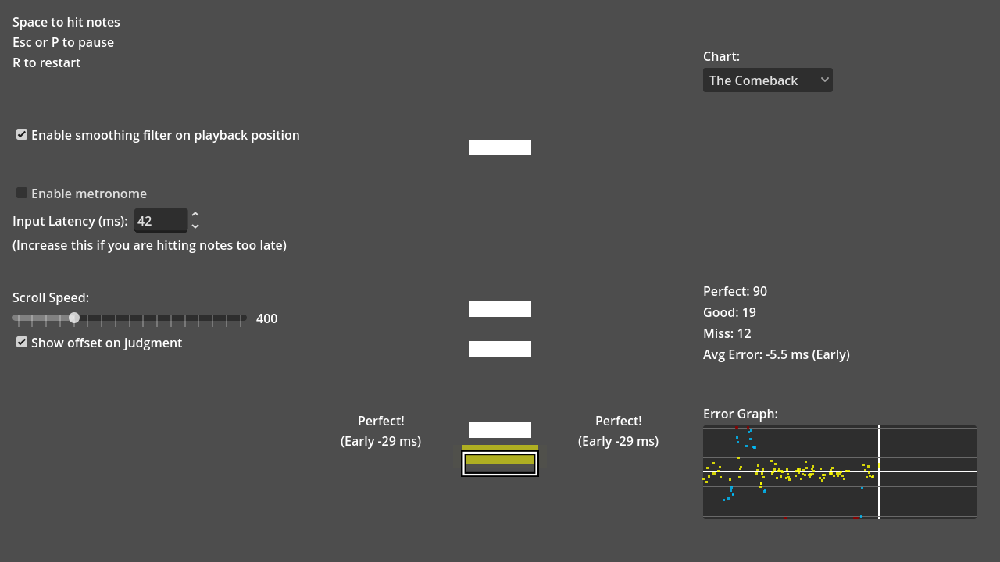
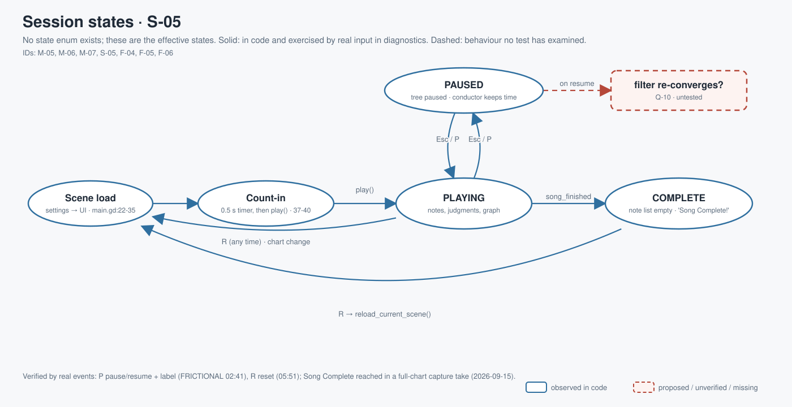
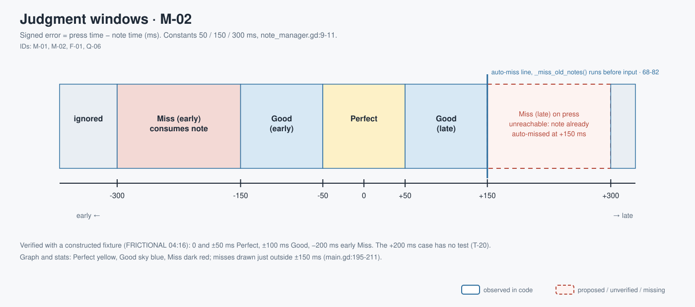
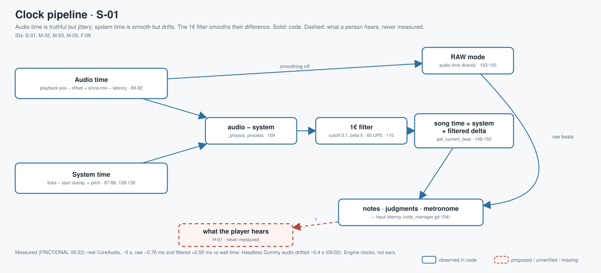

# walker-audio-rhythm-game — Game Design Document (recovered)

| | |
|---|---|
| Version | 0.1.0-recovered |
| Date | 2026-09-27 |
| Author | Zelda (agent, silent), for Nik Bear Brown |
| Mode | recovered, `/gdd reverse --path godot silent` |
| Revision | 1 |
| Gates | vision ○ · systems ○ · world ○ · scope ○ — gate — unsigned at time of writing |
| Engine | Godot 4.7 project (`config/features "4.7", "GL Compatibility"`); logs show 4.7.2 |
| Source | Godot demo `audio/rhythm_game`, upstream commit `a3b5c113112f77291d5f3d1360f33a882fdc52f7` per series ledger, MIT |
| Inputs read, not modified | `GAME-BRIEF.md`, `SOURCES.md` (root); `evidence/` and `youtube/` media ignored |

Provenance tags: `[OBSERVED path:line]` the code (or a named document) says this · `[INFERRED]` the code implies this, evidence stated · `[MISSING]` nobody has decided this. Paths are relative to `godot/` unless they start with a folder name. Observed elements are solid in the diagrams; proposed, unverified or missing ones are dashed.

**This one is a game.** Small, one-button, one-lane, two charts, but it has a player goal (hit notes on time), feedback, a failure signal (miss), an end state (Song Complete) and a replay loop. `GAME-BRIEF.md` exists and states an intent; it is an unsigned working brief, not an approved vision, and this document treats it that way.

*Upstream screenshot shipped with the Godot demo. It is not one of Walker's own captures; those live in `evidence/` and were deliberately not used for this pass.*

## 1. Vision summary

**Logline.** Notes fall onto a guide in time with a song; press Space on the beat; the game tells you, in milliseconds, how early or late you were `[OBSERVED scenes/main/main.gd:49-57, 97-119; game_state/note_manager.gd:85-126]`.

**Stated purpose.** "Teach audio-clock-driven motion through a playable one-button rhythm demo. Preserve the upstream chart, visuals and timing algorithm; make small evidenced improvements." `[OBSERVED GAME-BRIEF.md:3-5]`. Unsigned brief.

**Player fantasy.** `[MISSING]` Q-03. The code suggests "I am locked to the beat, and I can prove it with numbers" `[INFERRED from the error graph and average-error label, main.gd:148-211, 53-57]`.

**Player.** `[MISSING]` Q-02. Keyboard or gamepad, one button `[OBSERVED project.godot:34-52]`.

**The promise.** Every press gets a judgment and a signed offset; the chart ends; you can restart and compare `[OBSERVED main.gd:97-128; GAME-BRIEF.md:7-8]`.

**The whole game.** One scene: chart selector, settings column, stats column, one lane of notes, a guide, an error graph. No menus, no progression, no saving `[OBSERVED scenes/main/main.tscn:12-270]`.

**Biggest unresolved question.** Is Walker's goal to teach the clock (keep it a demo) or to grow a game (more charts, grades, persistence)? The brief says the first; nothing says whether the second ever follows. Q-01.

## 2. Design pillars

`[MISSING]` as pillars. The brief gives constraints `[OBSERVED GAME-BRIEF.md:3-5]`; the code shows what it protects `[INFERRED]`:

| ID | Candidate pillar | Protects | Evidence | Status |
|---|---|---|---|---|
| P-01? | The audio clock is the truth | Judgments match what the player hears | song time from playback position + time-since-mix − output latency `[conductor.gd:69-82]`; smoothed toward it, never replacing it `[conductor.gd:93-110]` | `[INFERRED]` |
| P-02? | Show the error, not just the grade | The player can calibrate | signed offsets `[main.gd:99-104]`, average error `[main.gd:53-57]`, graph `[main.gd:148-211]`, latency setting `[main.gd:131-134]` | `[INFERRED]` |
| P-03? | Preserve upstream timing; change only with evidence | Teaching integrity | `[OBSERVED GAME-BRIEF.md:4-5]`; only change is an empty-list guard `[note_manager.gd:86-88]` | brief, unsigned |

**Pillar collision.** P-01 vs smooth motion: raw audio time is jittery, system time drifts. The code's ruling is to filter the *difference* and add it to system time `[conductor.gd:97-110]`, and to shift judgment by input latency rather than re-snap notes `[note_manager.gd:150-154]`. That is a recovered ruling, not an approved one.

## 3. Core loop

**Micro (≈0.13–2 s).** Watch the next note approach the guide → press Space → judgment text + note colour + dot on the graph → next note `[OBSERVED note.gd:73-79; guide.gd:6-12; main.gd:97-119]`. Deciding: when to press. Risk: a miss. Reward: Perfect, and a small offset.

**Meso (one chart, ≈1 min 40 s).** Count-in → 171 notes (The Comeback) or 177 (Sync Test) → Song Complete `[OBSERVED chart_data.gd; note_manager.gd:31-48, 64-65; main.gd:126-128]`. 45 measures × 4 beats at 116.052 BPM with an 8.283 s first-beat offset `[OBSERVED main.tscn:23-24; INFERRED ≈101 s of chart]`. Walker's full-chart capture ran 103.8 s and ended 150/14/7 with Song Complete `[OBSERVED FRICTIONAL.md 2026-09-15 entry]`.

**Macro (session).** Adjust latency / smoothing / scroll speed → restart → compare counts and average error. Settings survive restarts within the session through the `GlobalSettings` autoload; nothing is saved to disk `[OBSERVED project.godot:16-18; global_settings.gd; main.gd:22-28]`.

**Loop honesty test.** Strip the song and the graph: a timed button press against a moving marker, with feedback. Still a game, a very small one. The graph and settings make it a *tuning* game, which matches the teaching purpose.

## 4. Player Experience Goals

`[MISSING]` Q-03. Candidates, `[INFERRED]`, unapproved:

| ID | The player should feel… | when… | Evidence it could be tested | Status |
|---|---|---|---|---|
| PX-01? | "The notes are on the beat I hear." | the song plays | clock design P-01 | no human listening yet `[OBSERVED SOURCES.md:12-13]` |
| PX-02? | "I know whether I'm early or late, and by how much." | after any press | offsets + graph | UI verified by automation only |
| PX-03? | "Changing latency made my hits better." | after calibration | latency setting | unverified; CAPTURE-PLAN warns a number is not heard sync |
| PX-04? | "I want one more run." | Song Complete | R restart | untested with people |

## 5. Mechanics

### M-01 Hit `[OBSERVED]`
Action `main_key`: Space (physical 32) or gamepad button 0 `[project.godot:34-38]`. Polled in `NoteManager._process` after misses are cleared `[note_manager.gd:59-62]`. Judges only the oldest note `[note_manager.gd:89]`. Walker change: returns early if the list is empty, because the last note can expire earlier in the same frame `[note_manager.gd:86-88; FRICTIONAL.md 04:48]`. Verified: a live Space press on the first real chart note scored Perfect and the label read "Perfect: 1" `[FRICTIONAL.md 05:19]`.

### M-02 Judgment windows `[OBSERVED]`
Constants 50 / 150 / 300 ms `[note_manager.gd:9-11]`. |Δ| ≤ 50 → Perfect; ≤ 150 → Good (early/late); ≤ 300 → Miss (early/late); earlier than −300 → press ignored `[note_manager.gd:91-126]`. Any note more than 150 ms late is auto-missed before input is read `[note_manager.gd:68-82]`. Consequence `[INFERRED]`: the late 150–300 ms "Miss" branch on a keypress is effectively unreachable; only early misses consume a note on a press. Q-06. Verified with a constructed fixture: 0 and ±50 ms Perfect, ±100 ms Good, −200 ms early Miss, empty input safe `[FRICTIONAL.md 04:16, 04:48]`.

### M-03 Note motion `[OBSERVED]`
Position `y = speed·Δt` before the line; after it, `y = speed·Δt − speed·Δt²`, decelerating `[note.gd:73-79]`. Speed from `GlobalSettings.scroll_speed` (default 400), live-updated by signal `[note.gd:16-21, 82-83; global_settings.gd:10-14]`. On hit the note freezes, colours (yellow Perfect / sky-blue Good / dark red Miss), fades and frees; an auto-missed note keeps moving while it fades `[note.gd:37-70; note_manager.gd:75]`. Verified at 120 BPM / 400: y = −200, 0, 100 one beat before, at and after `[FRICTIONAL.md 03:13]`.

### M-04 Guide pulse `[OBSERVED]`
Every `main_key` press scales the guide to 1.2 and eases back in 0.2 s, hit or not `[guide.gd:6-12]`.

### M-05 Pause `[OBSERVED]`
Action `pause`: Esc, P, gamepad 6 `[project.godot:40-46]`. `PauseHandler` (process mode always) toggles `get_tree().paused` and the "Paused" label `[pause_handler.gd:5-8; main.tscn:15-17, 196-213]`. The conductor also runs always `[conductor.gd:51-54; main.tscn:20]`, so the system clock keeps counting through a pause `[INFERRED conductor.gd:87]`; how quickly the filter re-converges on resume is untested. Q-10. Verified: real P events pause and resume and toggle the label `[FRICTIONAL.md 02:41]`.

### M-06 Restart `[OBSERVED]`
Action `restart`: R or gamepad 3 `[project.godot:47-52]` → `reload_current_scene()` `[main.gd:44-45]`. Verified: Perfect count resets to zero after a real R press `[FRICTIONAL.md 05:51]`.

### M-07 Song Complete `[OBSERVED]`
When the note list empties, `song_finished` fires once and shows "Song Complete! Press R to play again" `[note_manager.gd:64-65, 129-130; main.gd:126-128; main.tscn:175-192]`.

### M-08 Settings `[OBSERVED]`
Smoothing filter on/off (switches FILTERED / RAW time) `[main.gd:60-65, 85-86]`; show offset on judgment `[main.gd:89-90]`; metronome `[main.gd:93-94]`; input latency −100…1000 ms, default 20 `[main.tscn:84-87; global_settings.gd:8; main.gd:131-134]`; scroll speed 200…1000 step 50 `[main.tscn:110-116; main.gd:137-139]`; chart selector reloads the scene `[main.gd:142-145]`. Mouse toggling of the offset checkbox verified in the native-size capture viewport `[FRICTIONAL.md 11:39]`; the other controls are covered by Walker's capture takes, not by assertions `[FRICTIONAL.md 2026-09-15]`.

### M-09 Metronome `[OBSERVED]`
Plays a click when the floor of the current beat increases; 16-beat count-in; off by default `[metronome.gd:6-21; global_settings.gd:7]`. The code adds output latency (seconds) to a beat count `[metronome.gd:18]`, a possible units mismatch flagged in Walker's source audit and not runtime-confirmed `[OBSERVED FRICTIONAL.md 2026-09-14]`. The upstream comment admits ticks round to the ~11 ms mix window `[metronome.gd:14-17]`. Q-07.

## 6. Systems

### S-01 Conductor clock `[OBSERVED]`
Audio time = playback position − first-beat offset + time since last mix − cached output latency, with a guard for a Web underflow bug `[conductor.gd:61-82]`. System time = ticks since a start stamp that includes offset, time-to-next-mix and latency, × pitch scale `[conductor.gd:87-88, 128-139]`. In `_physics_process` a 1€ filter (cutoff 0.1, beta 5, "tuned for 60 UPS") smooths audio − system, and the song time is system + filtered delta `[conductor.gd:27-31, 93-110, 117-122, 148-150]`. Raw mode uses audio time directly `[conductor.gd:153-155]`. Walker measured, with real CoreAudio over ~5 s, raw and filtered clocks within about −0.76 ms and +2.55 ms of wall time; under the headless Dummy driver they drifted by ~0.4 s `[FRICTIONAL.md 09:02, 09:33]`. Neither is heard synchronisation.

### S-02 Chart `[OBSERVED]`
Charts are arrays of measures; each measure is subdivided evenly by its own length, 4 beats per measure `[note_manager.gd:31-40]`. The Comeback uses 16 steps per measure, Sync Test 4 `[chart_data.gd]`. 45 measures each; 171 and 177 notes `[OBSERVED count of 1s in chart_data.gd]`. BPM 116.052, offset 8283 ms are scene values for the one song; Sync Test reuses the same song and tempo `[main.tscn:19-24; INFERRED no per-chart song field exists]`.

### S-03 Stats `[OBSERVED]`
`PlayStats` resource emits `changed` on any field change `[play_stats.gd]`. Mean error averages every judged press including misses `[note_manager.gd:98-122]`; auto-missed notes do not enter the mean `[note_manager.gd:73-78]`. Labels "Perfect/Good/Miss: n" and "Avg Error: ±x ms (Early/Late)" `[main.gd:49-57]`; the scene's initial text reads "Avg Hit Offset: 0.0 ms" until the first update `[main.tscn:149-151]`.

### S-04 Error graph `[OBSERVED]`
Horizontal guides at ±50 and ±150 ms, one dot per judgment at (beat, error), misses pinned just outside ±150, colour by type, plus a moving time marker `[main.gd:148-219]`.

### S-05 Session state `[OBSERVED]`
No explicit state enum. Effective states: count-in (0.5 s timer, then conductor + metronome start) → playing → paused ↔ playing → complete; R from any state reloads `[main.gd:37-45; pause_handler.gd; note_manager.gd:129-130]`.

## 7. Progression

Two charts, both selectable at any time; no unlocks, grades, high scores or persistence `[OBSERVED main.gd:142-145; no save code in godot/]`. Whether any is wanted `[MISSING]` Q-11.

## 8. World

None. A dark play field, one lane at x = 640, guide at y = 594 `[OBSERVED main.tscn:30-36]`. `[MISSING]` whether a world is ever wanted; Q-13.

## 9. Narrative

None `[OBSERVED]`. No lore recovered, none invented. Q-13.

## 10. Characters

None `[OBSERVED]`. Q-13.

## 11. Features and priority

| ID | Feature | Code | Evidence level | Priority |
|---|---|---|---|---|
| F-01 | Hit + judgments | M-01, M-02 | fixture + live Space | `[MISSING]` |
| F-02 | Note motion | M-03 | constructed samples | `[MISSING]` |
| F-03 | Guide pulse | M-04 | code read | `[MISSING]` |
| F-04 | Pause | M-05 | real P events | `[MISSING]` |
| F-05 | Restart | M-06 | real R event | `[MISSING]` |
| F-06 | Song Complete | M-07 | full-chart capture take | `[MISSING]` |
| F-07 | Settings (smoothing, offsets, metronome, latency, scroll, chart) | M-08 | one mouse toggle asserted; rest shown in capture takes | `[MISSING]` |
| F-08 | Metronome | M-09 | clicks measured in engine mix; units question open | `[MISSING]` |
| F-09 | Conductor clock | S-01 | clock-progress diagnostic | `[MISSING]` |
| F-10 | Stats + graph | S-03, S-04 | live label; graph shown in captures | `[MISSING]` |
| F-11 | Empty-input guard (Walker) | M-01 | fixture | `[MISSING]` |

CORE percentage cannot be computed: no priorities exist `[MISSING]` Q-04.

## 12. Out of scope (observed absences)

Multiple lanes, holds, chart editor, audio-offset auto-calibration, online anything, saving, menus, difficulty levels `[OBSERVED]`. The brief rules out publication and paid generation for this continuation `[OBSERVED GAME-BRIEF.md:18-19]`.

## 13. Technical

Godot 4.7 features, `gl_compatibility` on desktop and mobile, 1280×720 viewport, canvas_items stretch, vsync off, `run/max_fps=1000` `[project.godot:9-57]`. Web default playback type 0 `[project.godot:12-14]`. Autoload `GlobalSettings` `[project.godot:16-18]`. Headless import exits 0; abrupt headless exits leak four Ogg playback objects and hold two resources, which an orderly stop + 200 ms drain avoids in diagnostics `[OBSERVED FRICTIONAL.md 00:53-06:54]`. Runtime game sources are unchanged apart from the title and the empty-input guard `[OBSERVED GAME-BRIEF.md:5; FRICTIONAL.md 2026-09-15]`. Target platforms `[MISSING]` Q-12. Hardware latency calibration `[MISSING]` Q-09.

## 14. Risks

| ID | Risk | Cat | L/I | Trigger | Mitigation |
|---|---|---|---|---|---|
| R-01 | Automated timing tests presented as heard synchronisation | Evidence | H/H | any "in sync" claim | keep the brief's boundary sentence; H-01 listening test |
| R-02 | Music distributed before track provenance is settled | Legal | M/H | any film or push with the song | SOURCES.md review (Q-08) |
| R-03 | Late-press misses never register as misses | Design | M/M | player notices late presses "do nothing" | Q-06 |
| R-04 | Metronome drifts from notes if the units mismatch is real | Design | M/M | metronome on, compare to notes | Q-07 |
| R-05 | Pause resume jumps notes while the filter re-converges | Design | M/L | long pause | Q-10 |
| R-06 | Ogg teardown warnings on abrupt exit | Technical | H/L | headless tests | orderly stop in harnesses (done) |
| R-07 | Zero human playtests | Production | H/H | any PX claim | H-01..H-03 |

**Top 3.** R-01 is the one that can make every teaching claim false. R-02 is the one that can stop distribution. R-07 is why every PX goal above is still a guess.

## 15. Open questions

In `decisions.md`: Q-01 demo or growing game · Q-02 player/learner · Q-03 PX goals · Q-04 pillars/priorities · Q-05 scoring beyond counts · Q-06 late-miss window · Q-07 metronome units · Q-08 music provenance · Q-09 latency calibration · Q-10 pause re-convergence · Q-11 progression/persistence · Q-12 target platforms · Q-13 world/narrative/characters · Q-14 more charts or songs.

## 16. Tests

Existing `[OBSERVED]` (diagnostics under `godot/`, results in FRICTIONAL.md): `test_hit_windows_scene.gd` + `.tscn` (6 timing cases + empty input); `test_hit_windows.gd` (standalone variant, kept as failure evidence: could not resolve the autoload); `test_note_motion.gd`; `test_live_hit.gd`; `test_live_restart.gd`; `test_pause_input.gd`; `test_shutdown.gd`; `test_clock_progress.gd`; `test_viewport_pilot.gd` (failed size assertion, 3840×2008); `test_subviewport_pilot.gd`, `test_subviewport_input.gd`, `test_subviewport_mouse.gd`, `test_subviewport_restart.gd` (failed: nested current_scene), `test_wrapper_restart.gd` + `test_capture_wrapper.tscn`, `test_audio_capture.gd`, `test_av_pilot.gd`. These are capture and engine checks, not playtests.

Proposed (dashed until they exist):

| ID | Setup | Action | Expected | Links |
|---|---|---|---|---|
| T-20 | fixture | press at +200 ms | decide per Q-06 (today: note already auto-missed) | M-02 |
| T-21 | metronome on | 16 bars | clicks within one mix window of beat boundaries | M-09, Q-07 |
| T-22 | pause 10 s, resume | next 8 notes | judgment error distribution matches pre-pause | M-05, Q-10 |
| H-01 | human, headphones | play The Comeback uncoached | says whether notes match the music | PX-01 |
| H-02 | human | calibrate latency, replay | average error moves toward 0 | PX-03 |
| H-03 | human | finish chart | wants another run, or says why not | PX-04 |

## Zelda's notes (silent mode; what I would have said out loud)

| Mode | Rating | Why |
|---|---|---|
| Ghost Center | PARTIAL | The brief states a teaching purpose; no player-facing vision exists. |
| Mechanic Mirage | PRESENT (expected) | No PX goals; §4 are candidates. |
| Implementation Void | PARTIAL | Late-press misses, pause re-convergence and metronome units are unhandled or unexamined cases. |
| Priority Inflation | N/A | No priorities. |
| Novelist's Trap | ABSENT | No lore, correctly. |
| Completeness Fallacy | PARTIAL | Music provenance and the late-miss asymmetry were buried in logs and code; now Q-08, Q-06. |
| Stagnant Artifact | ABSENT | FRICTIONAL.md is an unusually honest history. |

1. **This is the best-evidenced project in the batch, and it still has zero listeners.** Every clock number here is a measurement of the engine, not of a person. H-01 is cheap and it is the only test that answers the brief's own question.
2. **The late-miss asymmetry is a design decision nobody made.** Press 200 ms early: the note is consumed as a Miss. Press 200 ms late: nothing, because the note already left. Players feel that as "the game ignored me." Keep it or change it, but decide.
3. **The metronome line is either a bug or a very odd choice.** Adding seconds to beats only "works" because the latency is small. Confirm it before a film shows the metronome as proof of sync.
4. **First fix:** Q-08. A teaching film that cannot ship its own soundtrack is not a film.
